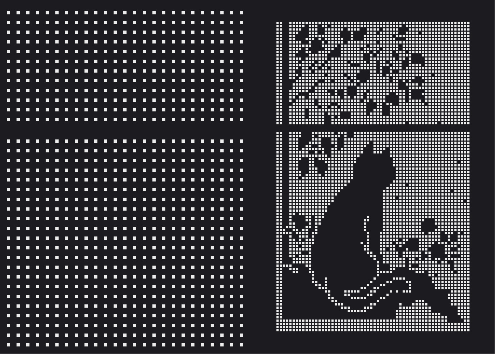
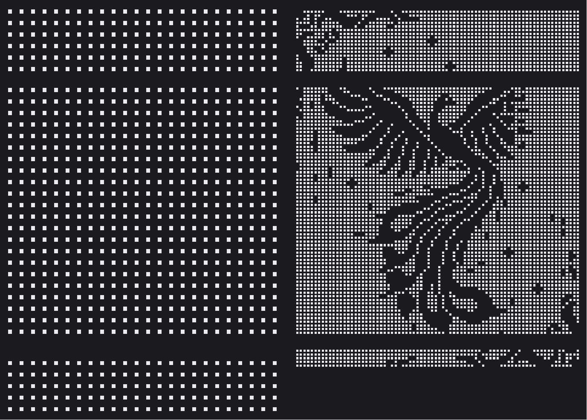
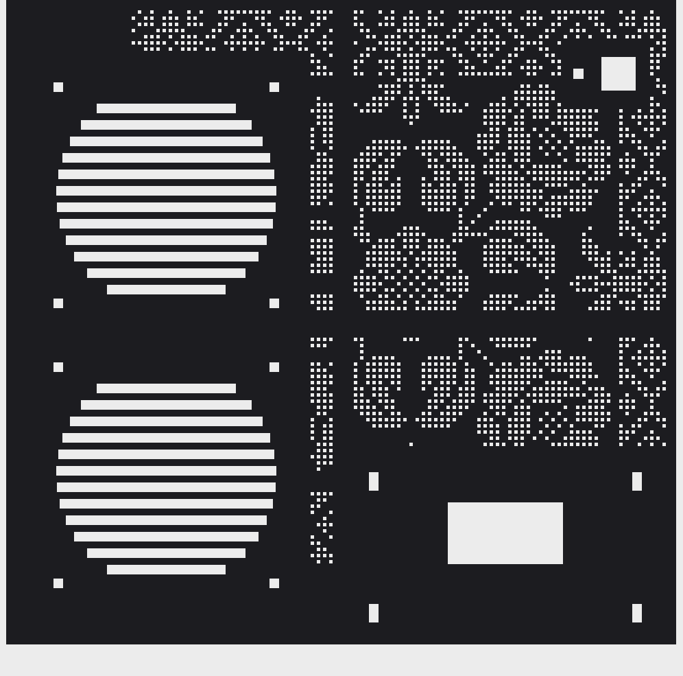
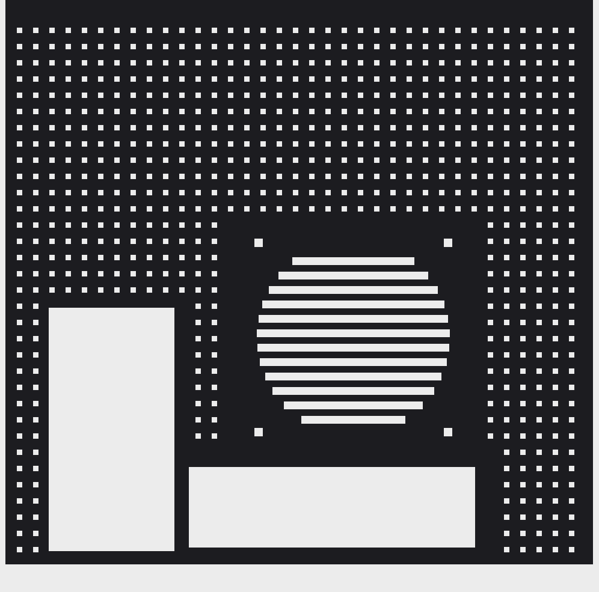
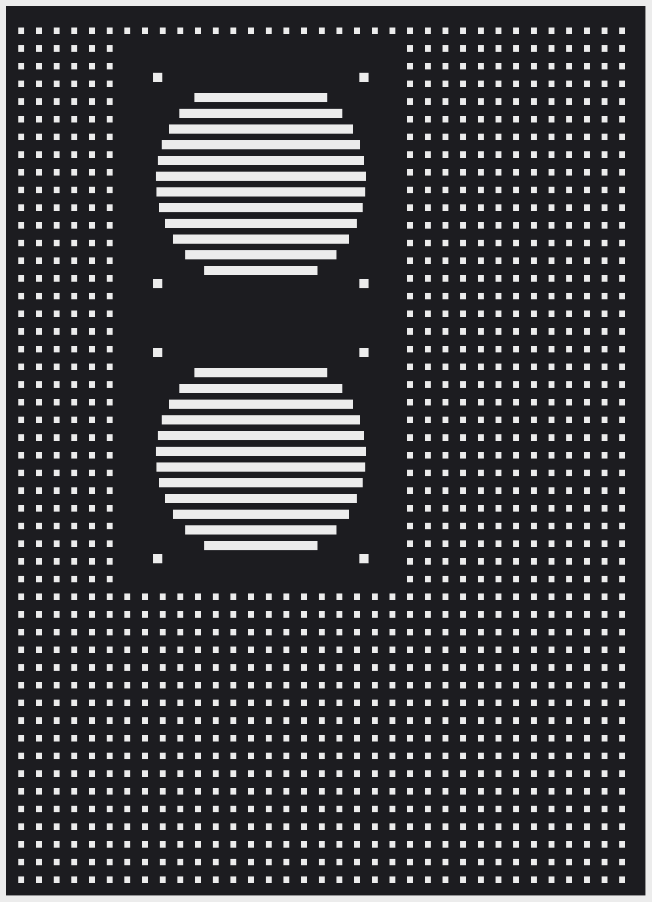

# Stitch-panel micro-ATX case

A PETG case for a 250 mm bed. The motherboard sits on the floor, the power supply sits in front of it, and the two cheeks are the cross-stitch charts: the cat on the left, the phoenix on the right. The front is the floral chart. The rear keeps the plain square stitch. Open cells are the vents. A grey sheet behind each chart is what makes the black stitches read.

The print files are in [`flat_case_printable_parts.zip`](flat_case_printable_parts.zip) (120 STLs). [`flat_case_assembly_with_parts.stl`](flat_case_assembly_with_parts.stl) is the whole case with the parts in place. [`flat_case_assembly_shell.stl`](flat_case_assembly_shell.stl) is the plastic only.

Outer size is **332 × 459 × 328 mm** (width × depth × height), about 50 litres. It is tall on purpose. The charts are portrait, and the stitch has to stay large enough for a 0.4 mm nozzle (cat holes 1.85 mm, phoenix holes 1.70 mm, web between holes 1.15 mm).

The solid horizontal bars are the joints. They are forced-solid rows of the chart, so the seam does not cut the cat or the bird. Front, top, and rear use the same square stitch as a texture.

## The board does not need case screws

The floor has a socket at each of the nine micro-ATX holes. A printed post presses into the socket, and a locating pin drops through the board into the post. Four clips slide in channels in the floor and hook over the edge of the PCB. That is the whole mount: no metal screws into the case.

The Thermalright kit still uses its own screws and backplate. Those are separate from the missing case screws. The posts hold the board 7.5 mm off the floor, which clears a 6.35 mm backplate, and the floor is pocketed another 2 mm under the socket (110 × 110 mm) so the backplate has room.

Print one post and one pin first and try them in a real hole before gluing anything. Some B560M boards leave hole S out. Only glue a post where the board actually has a hole. The unused socket is just a recess.

If a clip lands on a header, slide it along its channel. The left clip sits on the front half of the slot edge so it misses the GPU bracket. The right clip sits on the rear half of the gutter so it misses the 24-pin.

## What fits

| Part | How it sits |
| --- | --- |
| B560M, up to 244 × 244 mm | Flat on the floor, I/O at the rear. Shorter boards are fine; posts are independent. |
| 2× DDR4 | Right of the cooler. Modeled at 34 mm tall. Taller sticks: slide the cooler's fan up on its clips. The fins start 36 mm above the PCB and do not cover the RAM. |
| GTX 1660 Super, dual slot | Top PCIe slot, standing up. Clearance from the rear bracket to the front fan is about **420 mm**, so any 1660 Super fits. The card's underside is only about 10 mm off the floor. |
| Assassin X120 Refined SE | 148 mm tall. Top of the cooler is at 176 mm; the top fan's underside is at 300 mm, so the chimney above it is open. |
| ATX 650 W, up to 180 mm long | Front-right bay, **fan down**, AC plug at the front. Bay is 150 × 178 × 86 mm. |
| Arctic P12 Pro ×5 | Two front intakes stacked on the left, two lid exhausts (one over the CPU, one forward of it), one rear exhaust above the I/O. 105 mm screw pattern. |

The rear GPU opening is one window rather than four precise slot holes. A given B560M's slot centerline is a few millimetres off a generic drawing, and a window still takes a dual-slot bracket. Test-fit the rear tiles on the installed card before the cheeks are glued. `slot_cover_x2.stl` blanks the unused part of that window. `gpu_pad_6mm`, `8mm`, and `10mm` are optional anti-sag pads.

The CPU pocket is placed for a typical LGA1200 socket (about 112 mm from the slot edge, 86 mm from the rear edge). The pocket is ±55 mm, so a modest difference still covers the backplate. The nine standoff positions are the micro-ATX holes, not an estimate.

## Colour

Black for the shell, posts, pins, clips, feet, battens, slot covers, GPU pads, and the PSU stops. Grey only for the backing sheets (`backing_left_*.stl`, `backing_right_*.stl`, `backing_front_*.stl`). Glue a grey sheet about 3.5 mm behind each art tile. The join bars are solid, so a batten behind them does not show through as a stripe. The rear has no grey sheet. It is the plain square field, and it vents straight through.

## Print

PETG, 0.4 mm nozzle, 0.2 mm layers, 4 walls. The art panels are 3 mm, so they are all wall and need no infill. Every STL is already oriented to print flat. No supports.

The zip has the 120 parts. The two long cheek tiles are **233 mm**. Center them. A thin brim is fine; a wide skirt will not fit a 250 mm bed. Every other tile is at most 226 mm.

About **3296 g** of plastic if the walls print solid. The 3 mm walls are essentially all perimeter, so that number is close to the real filament use: a bit over three 1 kg spools, almost all black, plus a little grey.

If the stitch holes close up, set a small positive hole-size compensation (about +0.1 mm) rather than scaling the part.

## Build

1. Print `standoff_post_x9.stl` and `locating_pin_x9.stl`. Confirm a pin passes a board hole and seats in a post.
2. Print the floor (`bottom_lo_*`, `bottom_hi_*`). Press posts into the sockets that match real holes. Set the board on them and check the socket area sits over the pocket before any glue.
3. Drop the pins in. Slide the four `edge_clip` parts into the floor channels until the lip rests on the PCB.
4. Glue cheek, front, rear, and lid tiles edge to edge, then glue a batten behind each seam. Battens are black. In the 3D preview they are drawn orange only so the joints are visible.
5. Glue the grey backings behind the art.
6. PSU goes in fan-down. The front panel has the inlet and four slotted screw holes for the screws that came with the supply. Glue the two `psu_corner_stop` blocks to the floor at the inner bottom corners of the supply so it cannot slide toward the board. Cables leave above the stops, through the 22 mm gap.
7. Five fans, all intake-to-exhaust the same way: the two on the front pull air in, the two on the lid and the one on the rear push it out. Screw them in with the Arctic screws. The P12 Pro PST cables daisy-chain, so the two front fans can share one header and the two lid fans can share another. The 16 mm hole on the upper right of the front is a power button; the small hole beside it is an LED. Both wire to the front-panel header.
8. The I/O cutout is the ATX shield size, and only the outer 1.2 mm of the rear panel is the clip edge (the rest is relieved 8 mm). Sand that edge if the shield is tight.

Feet are 15 mm so the supply can breathe through the slots in the floor.

Open `flat_case_assembly_with_parts.stl` to see the board, cooler, RAM, GPU, supply, and fans in place. `flat_case_assembly_shell.stl` is the plastic only. `preview/floor_plan.png` is the top view with the lid off. `preview/overview.png` is the packaging view; it draws the panels as plain plates, so the stitch is only in the face renders above.

## Limits worth knowing

- The case is about 3.3 kg and 50 litres. The height is the stitch, not the cooler.
- The rear window is generous. Fit it to the card before the shell is glued shut.
- The AC inlet rectangle matches a typical ATX face. If a supply's switch or inlet sits outside it, file that one opening.
- The cooler's fan is not a hard obstacle in the model. It mounts on the side of the tower and can be raised for tall RAM.
- Regenerate everything with `python3 generate_case.py` (needs `numpy` and `matplotlib`). The charts are `patterns/cat.npy` and `patterns/phoenix.npy`, row 0 at the top of the picture, `True` meaning a solid stitch.
